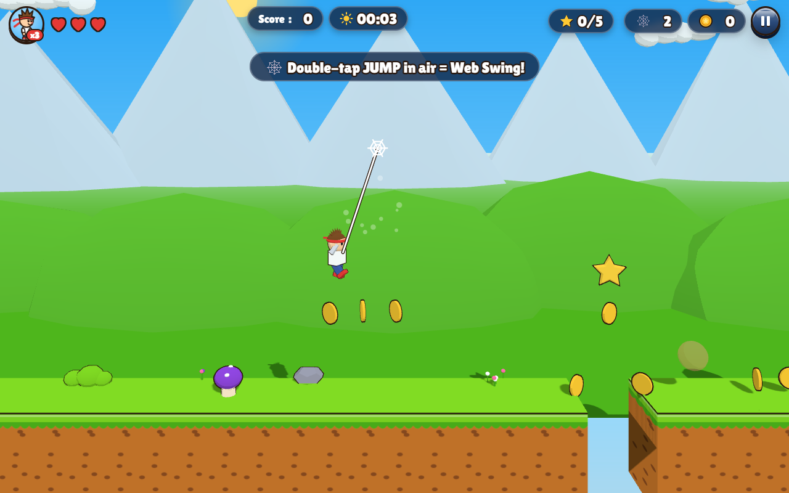
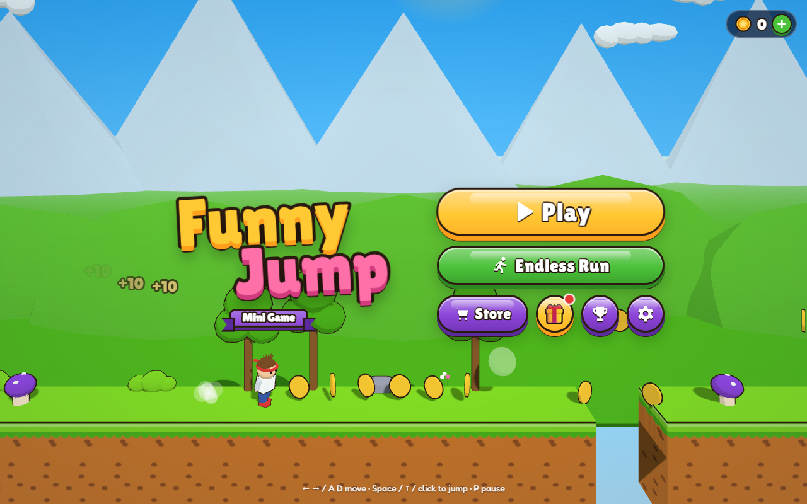
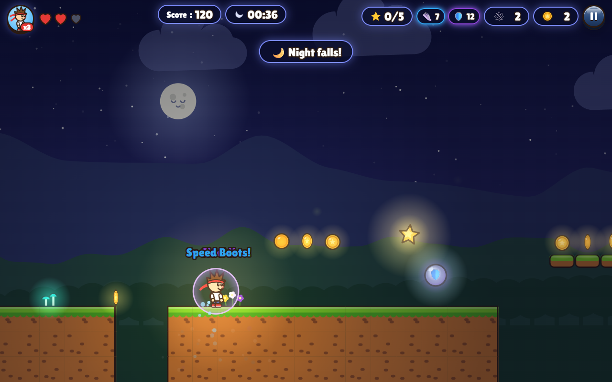
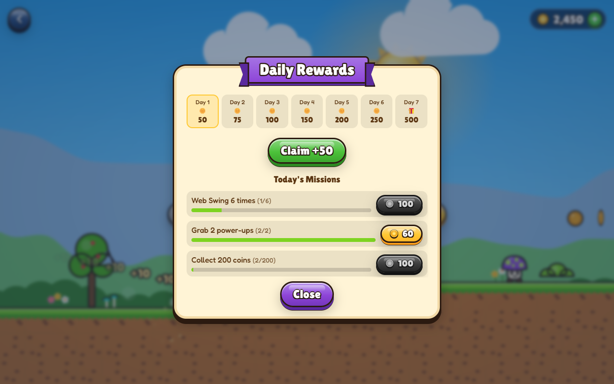

<div align="center">


# Funny Jump

### A bright cartoon 3D runner & platformer with a live day ↔ night cycle.

**Run. Jump. Web-swing across the sky.** Play in your browser, from the Chrome toolbar, or on Android, fully offline.

[](https://github.com/nikhilrana2715/Running-Game/releases/latest)
[](https://github.com/nikhilrana2715/Running-Game/actions/workflows/deploy-web.yml)
[](https://github.com/nikhilrana2715/Running-Game/actions/workflows/release.yml)
[](LICENSE)


%20%2B%202D-8E44D8)


**[▶ Play in browser](https://nikhilrana2715.github.io/Running-Game/)** ·
**[⬇ Download APK](https://github.com/nikhilrana2715/Running-Game/releases/latest/download/FunnyJump-debug.apk)** ·
**[🧩 Chrome extension zip](https://github.com/nikhilrana2715/Running-Game/releases/latest/download/funny-jump-extension.zip)**

[Features](#-features) · [Controls](#-controls) · [Install](#-install--play) · [Build from source](#-build-from-source) · [Deploy](#-deploy--release) · [Architecture](#-architecture) · [Roadmap](#-roadmap) · [FAQ](#-faq)



</div>

---

## ✨ Highlights

|  |  |
|---|---|
| 🧊 **Photo-real 3D world** | Real photographed sky panoramas (day, golden hour, Milky-Way night), photo-scanned trees, shrubs, grass and rocks, real soil/grass/wood textures, image-based lighting, soft shadows, bloom and atmospheric haze. | Switch between **3D HD / 3D Lite / 2D** in Settings. |
| 🌗 **Living world** | A real-time day → sunset → night → dawn cycle. Sky, sun/moon, stars, fireflies, glowing coins, lantern-lit darkness, the music *and* the UI colours all change with it. |
| 🕸️ **Web Swing** | Double-tap jump to shoot a web, zip forward and fling into a long glide. Tap again mid-flight to chain swings. |
| 🫧 **Power-ups** | Speed Boots, Super Jump, Shield, Coin Magnet, Heart and Web refills float along every run. |
| 🪙 **Progress that sticks** | Every coin you pick up is saved for good. Spend coins on skins and permanent upgrades. |
| 🎁 **Daily loop** | 7-day login streak plus 3 fresh missions every day. |
| 🌍 **World leaderboard** | Submit your Endless score and see the online World Top 20 (Supabase). |
| 📦 **One codebase, three platforms** | The same vanilla JS game ships as a PWA, a Chrome MV3 extension and an Android app. |

## 📸 Screenshots

<div align="center">

| Main menu | Night + power-ups |
|---|---|
|  |  |
| **Web Swing** | **Daily rewards & missions** |
|  |  |

</div>

## 🎮 Features

### Game modes
- **Adventure:** 24 levels across 6 worlds (Green Meadow → Sunset Peaks), 5 hidden stars per level, a mid-level checkpoint and a 1–3 ★ rating.
- **Endless Run:** auto-running mode that speeds up over time, scores by distance and has a faster day/night cycle.
- Levels are **procedurally generated but seeded**, so level *N* is always the same layout.

### Web Swing
| Action | Result |
|---|---|
| Double-tap **Jump** (2nd tap in mid-air) | Web sticks ahead-up and the hero zips along it |
| Release | Big forward fling plus a low-gravity glide (~1.5 s, ~8× a normal jump's distance) |
| Tap **Jump** while gliding | Chain another web |

3 swings per run (5 with *Web Shooter+*), refilled by 🕸️ bubbles (max 9). With no swings left, the second tap falls back to double jump.

### Power-ups (collect during a run)
| Bubble | Effect | Duration |
|---|---|---|
| 👟 Speed Boots | Run ×1.45 faster | 7 s |
| 🦘 Super Jump | Jump ×1.25 higher | 8 s |
| 🛡️ Shield | Blocks the next hit | 12 s |
| 🧲 Coin Magnet | Pulls coins from a wide radius | 10 s |
| 🕸️ Web | +1 Web Swing | n/a |
| ❤️ Heart | +1 health | n/a |

Active power-ups show as countdown chips in the HUD. The *Power Boost* upgrade makes them last 50% longer.

### Store: spend your saved coins
| Skins | Price | Upgrades | Price |
|---|---|---|---|
| Headband Hero | Free | ❤️ Extra Heart (4 hearts) | 1,000 |
| Controller Kid | 500 | 🪽 Double Jump | 1,500 |
| Night Ninja | 800 | 🧲 Coin Magnet (permanent) | 1,200 |
| Bubble Girl | 1,000 | 👟 Swift Feet (+12% speed) | 800 |
| Robo Runner | 1,500 | 🦘 Spring Legs (+10% jump) | 900 |
|  |  | 🕸️ Web Shooter+ (+2 swings) | 1,000 |
|  |  | ⚡ Power Boost (+50% duration) | 1,200 |
|  |  | 💖 Revive ×3 | 300 |

Coins are banked when you finish a level or hit game over, and also when you quit, restart, or close/minimise the app, so you never lose them.

### Obstacles & combos
- 🪨 **Crumbling platforms:** stone slabs over gaps shake when you land, drop after 0.5 s, and respawn 3 s later.
- 🐔 **Egg-bomber chickens:** in later levels, flying chickens drop eggs when you run underneath.
- 🔥 **Coin combo:** grab coins less than 0.9 s apart to build a streak. Every 8 coins raises the score multiplier (up to **x5**) and adds +3 bonus coins.

### Daily rewards & missions
- **Login streak:** 50 → 75 → 100 → 150 → 200 → 250 → **500 coins + free Revive** on day 7.
- **3 daily missions** (e.g. *Web Swing 6 times*, *Stomp 10 enemies*, *Collect 200 coins*) worth 50–150 coins each.

### 3D graphics
- Real 3D scene (three.js, bundled locally, so it works offline and inside the extension): block terrain, a 3D hero for every skin, 3D enemies, coins, stars, chests, power bubbles and goal gate.
- Realistic look: physically based materials + ACES tone mapping, image-based lighting from the live sky, procedural textures, noise-sculpted hills and snow-capped mountains, a forest line, soft billboard clouds and distance haze (aerial perspective).
- Day ↔ night drives a shader sky (sun disc, glow, moon), light colour, soft shadows, fog, starfield, a hero lantern at night and glowing coins and boxes.
- **Graphics setting:** *Auto* (HD on desktop, Lite on phones and the popup), *3D HD* (shadows, high DPI), *3D Lite* (no shadows, lower DPI), *2D* (the classic renderer). Without WebGL the game falls back to 2D on its own.
- Gameplay physics are identical in 2D and 3D, so levels, scores and saves are shared.

### Polish
Coyote time, jump buffering, variable jump height, squash & stretch, screen shake, particles, synthesized SFX and adaptive music, haptics on Android, an English / हिन्दी UI and trophies.

## 🕹️ Controls

| Action | Keyboard | Mouse | Touch | Gamepad |
|---|---|---|---|---|
| Move | ← → / A D | on-screen ◀ ▶ | ◀ ▶ (slide between) | D-pad / left stick |
| Jump | Space / ↑ / W / Z / K | click anywhere | JUMP or tap anywhere | A / B |
| Web Swing | double-tap jump | double-click | double-tap | double-press A |
| Pause | P / Esc | ⏸ | ⏸ / Android back | Start |
| Confirm | Enter | n/a | n/a | n/a |

Hold jump for a higher jump. In Endless Run, ◀ slows you down and ▶ speeds you up.

## 📥 Install & play

| Platform | How |
|---|---|
| 🌐 **Browser / PWA** | Open **[nikhilrana2715.github.io/Running-Game](https://nikhilrana2715.github.io/Running-Game/)**. In Chrome/Edge, click the *Install* icon in the address bar to get an offline app. |
| 🧩 **Chrome extension** | See the step-by-step guide below. |
| 🤖 **Android** | Download [`FunnyJump-debug.apk`](https://github.com/nikhilrana2715/Running-Game/releases/latest/download/FunnyJump-debug.apk), open it on the phone and allow *Install unknown apps*. Runs fullscreen in landscape. |

### 🧩 Install the Chrome extension (until it's on the Web Store)

1. Download **[funny-jump-extension.zip](https://github.com/nikhilrana2715/Running-Game/releases/latest/download/funny-jump-extension.zip)**.
2. **Extract** it: right-click → *Extract All…*. Chrome cannot load a `.zip` directly.
3. Open **`chrome://extensions`** in the address bar.
4. Turn on **Developer mode** (top-right switch).
5. Click **Load unpacked** and select the **extracted folder**, the one that directly contains `manifest.json`.
6. Click the 🧩 puzzle icon → 📌 pin **Funny Jump**. Click it to play in the popup, use ⛶ or **Alt+Shift+J** for a full tab.

> **Troubleshooting:** *"Manifest file is missing"* means you selected the parent folder, so pick the inner folder that contains `manifest.json`. Keep the folder; deleting it removes the extension.
> Works in Chrome, Edge, Brave and Opera (any Chromium browser).

## 🛠️ Build from source

**Requirements:** Node.js 18+. For Android you also need JDK 17 and the Android SDK (compileSdk 34).

```bash
git clone https://github.com/nikhilrana2715/Running-Game.git
cd Running-Game
npm install

npm run build          # -> dist/web, dist/extension, dist/funny-jump-extension-vX.Y.Z.zip
npm run serve          # play at http://localhost:5173
npm run android:apk    # -> dist/FunnyJump-debug.apk
```

| Script | What it does |
|---|---|
| `npm run build` | Copies `src/` into the web build (with a cache-busting service worker) and the extension build, then zips the extension |
| `npm run serve` | Local static server for `dist/web` |
| `npm run android:sync` | Build + `cap sync android` |
| `npm run android:apk` | Build + sync + Gradle `assembleDebug` |
| `node scripts/icons.mjs` | Regenerate PNG icons from the in-game art (headless Chrome) |
| `node scripts/store-assets.mjs` | Regenerate Chrome Web Store screenshots and promo tile into `store/` |

**Debug hook:** open `index.html?debug` to get `window.__fj.{game, demo, start(mode, level), Save}` in the console.

> Note: `npm run build` wipes `dist/` (including a previously built APK).

## 🚀 Deploy & release

Everything is automated with GitHub Actions:

| Trigger | Workflow | Output |
|---|---|---|
| Push to `main` | [`deploy-web.yml`](.github/workflows/deploy-web.yml) | Builds and publishes the web game to **GitHub Pages**; uploads the extension zip as an artifact |
| Push a tag `v*` | [`release.yml`](.github/workflows/release.yml) | Builds the extension zip and the Android APK, then attaches both to a **GitHub Release** |

```bash
# ship a new version
npm version minor --no-git-tag-version   # bump package.json (also the extension version)
git commit -am "Release v1.2.0"
git tag v1.2.0 && git push && git push --tags
```

One-time setup: **Settings → Pages → Source: GitHub Actions**.

### Vercel
`vercel.json` holds the build settings (`npm run build` → `dist/web`). Import the GitHub repo once at **vercel.com/new**; every push to `main` then redeploys.

### Supabase (online leaderboard)
Table `public.scores` (name, mode, level, score, distance, created_at) with RLS: anyone may **select** and **insert**, nobody may update or delete; CHECK constraints validate every column. The client (`src/js/online.js`) talks to PostgREST with the public *publishable* key. It needs no SDK and works in the extension too.

**Chrome Web Store:** the step-by-step publishing guide (listing text, privacy answers, images) is in [`docs/CHROME_WEB_STORE.md`](docs/CHROME_WEB_STORE.md).

## 🧱 Architecture

Vanilla JavaScript ES modules. The simulation runs in 2D (pixels). It is drawn either by the **3D renderer** (`render3d.js`, three.js r160 vendored in `src/vendor/`) or by the classic **Canvas 2D** renderer. There is **no bundler and no CDN**, so the game passes the strict MV3 extension CSP and runs fully offline. All models and art are generated in code, and all sound is synthesized with WebAudio.

```
src/
├── index.html            # all screens + HUD (no inline scripts – extension-CSP safe)
├── css/tokens.css        # design tokens; colours morph with day/night via --n
├── css/app.css           # components
├── js/
│   ├── main.js           # screens, HUD, store, settings, daily, platform glue, main loop
│   ├── game.js           # physics, web swing, power-ups, enemies, camera, rendering, lighting
│   ├── levelgen.js       # seeded procedural levels + endless streaming + power-up spawns
│   ├── render3d.js       # 3D scene: terrain chunks, hero/enemy models, lights, shadows, sky
│   ├── sky.js            # day/night phase -> sky state, 2D parallax background
│   ├── art.js            # every sprite, drawn in code
│   ├── audio.js          # synthesized SFX + step-sequencer music
│   ├── input.js          # keyboard, multitouch buttons, gamepad
│   ├── daily.js          # login streak + daily missions
│   ├── save.js           # versioned localStorage save
│   ├── config.js         # all tuning constants (physics, web, power-ups, store)
│   └── i18n.js           # English / Hindi
├── vendor/three.module.min.js  # three.js r160 (MIT), local copy
├── sw.js                 # offline cache (PWA)
└── privacy.html          # privacy policy
extension/                # MV3 manifest, popup, background worker
android/                  # Capacitor 6 Android project
scripts/                  # build, icons, store assets, dev server
.github/workflows/        # Pages deploy + release pipeline
```

| Decision | Why |
|---|---|
| three.js vendored, no bundler | 3D without a build step; local file keeps MV3 CSP + offline |
| 2D sim + 3D view | One physics engine; the 3D camera uses an off-axis frustum so the gameplay plane matches the 2D framing pixel-for-pixel (2D particles overlay exactly) |
| Procedural art & audio | Zero asset files, crisp at any resolution, easy to recolour per world |
| Seeded level generation | 24 handcrafted-feeling levels plus infinite endless mode from one generator |
| Capacitor 6 | Native Android wrapper with fullscreen, back button and haptics |
| Tuning in `config.js` | All feel parameters (jump, web swing, power-ups, prices) live in one place |

## 🗺️ Roadmap

- [x] 24 levels, Endless Run, day/night cycle
- [x] Web, Chrome extension and Android builds
- [x] Web Swing, power-ups, permanent coin wallet, new upgrades
- [x] Daily rewards & missions
- [x] Online leaderboard (Supabase) + Vercel config
- [x] CI: GitHub Pages + automated releases
- [ ] Chrome Web Store listing
- [x] Crumbling platforms, egg-bomber chickens, coin combos
- [x] Full 3D renderer (HD / Lite) with 2D fallback
- [ ] Boss levels
- [ ] Online leaderboard
- [ ] Signed Play Store release build
- [ ] Composed music tracks

## ❓ FAQ

<details>
<summary><b>Does it collect any data?</b></summary>

No. Progress is stored only in your browser/device (localStorage). There are no analytics, ads, trackers or network calls during play. The extension requests **no permissions**. See the [privacy policy](src/privacy.html).
</details>

<details>
<summary><b>Will I lose my coins if I close the game mid-run?</b></summary>

No. Coins are banked on finish, on game over, on quit/restart, and when the app goes to the background.
</details>

<details>
<summary><b>The web swing doesn't trigger.</b></summary>

The second tap must come within ~0.3 s of the first while you're in the air, and you need at least one 🕸️ charge (shown in the HUD).
</details>

<details>
<summary><b>How do I tweak the game feel?</b></summary>

Edit `src/js/config.js`: `GAME.player` for movement, `GAME.web` for swing distance/glide, `GAME.power` for power-up durations, and `UPGRADES` / `SKINS` for prices.
</details>

## 🤝 Contributing

Issues and pull requests are welcome.

1. Fork and create a branch: `git checkout -b feature/my-idea`
2. `npm install && npm run build && npm run serve` and test on desktop and mobile widths
3. Keep the rules: no runtime dependencies, no inline `<script>` / `on*=` handlers, and art/audio generated in code
4. Open a PR describing the change, with a screenshot or GIF for visual changes

## 🙏 Credits

Photo assets (sky panoramas, textures, tree/plant/rock scans) by **[Poly Haven](https://polyhaven.com)**, CC0. 3D engine: **[three.js](https://threejs.org)** (MIT). See [`tools/assets3d/README.md`](tools/assets3d/README.md) for the exact assets and the baking pipeline.

## 📄 License

[MIT](LICENSE) © 2026 Nikhil Rana

<div align="center">
<sub>Made with ☀️ and 🌙. If you enjoy it, leave a ⭐!</sub>
</div>
